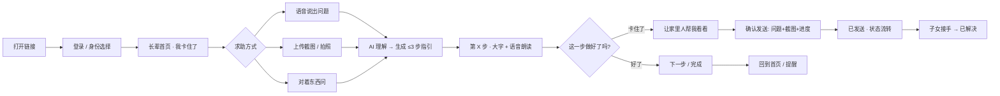

# 惦记 · H5 交付版交互流程

> H5 是可在线访问的"有效链接"主交付物；安卓完整版解决悬浮窗和实时屏幕共享，作为落地形态呈现。本文按页面梳理 H5 版交互细节与异常处理。

## 0. 总览流程图

---

## 1. 老人端逐屏交互

### 1.1 登录与身份
- 打开链接（浏览器/微信内）→ 手机号/微信登录 → 选择「我是长辈」；
- 首次使用：输入子女给的 6 位邀请码绑定 → 看 90 秒教学 → 进入首页；
- 后续直接进入首页；身份可在子女端「我的-身份管理」代管。

### 1.2 首页
- 一个大按钮：**「我卡住了」**；
- 下方一行：今天有 N 条待办（点击进提醒页）；
- 底部小字：卡住了？说一声。

### 1.3 求助方式（三选一，大字卡片）
1. **语音说出问题**：按住说话 / 直接说话 → 转文字（方言识别有限，听不懂就让老人描述界面或转子女）；
2. **上传截图/拍照**：相册选图或拍照；提示文案："先给当前界面截个图，再回来选这张图"；
3. **对着东西问**：打开摄像头，把看不懂的东西放进取景框。

### 1.4 AI 指引页（核心）
- 顶部状态：**"AI 正在看你的截图/听你的问题"**；
- 输出最多 3 步，每步一句话 + 大字 + 语音朗读（TTS）；
- 每步提供：「再讲一遍」「这步好了」「没搞定」；
- 支持语音命令："再讲一遍 / 下一步 / 卡住了 / 叫家里人"；
- 右下角常驻：**「让家里人帮我看看」**；
- 没有自动确认（H5 看不到后台屏幕）→ 由老人说"好了"或点按钮推进。

### 1.5 转子女确认页
- 展示将发送的内容：问题描述、截图、进行到第几步；
- 文案："会把刚才的对话和截图发给家里人，可以吗？"；
- 确认后进入状态页；可撤回。

### 1.6 状态页（求助状态机）
- 等待处理 → 子女接手 → 已解决，老人端可见并可撤销；
- 已解决后显示"谢谢你帮我弄好啦"，可一键回到首页。

### 1.7 提醒页
- 打开 H5 时展示待办列表（吃药、认证到期、复诊）；
- 每项一个「办好了」；状态回传子女端；
- 推送说明：H5 自身无法推送；接入公众号服务通知可推送（需服务号资质），否则为"打开时提醒"。

---

## 2. 子女端逐屏交互（Web）

1. **收件箱**（顶部可切换外公/外婆/奶奶）：求助卡片 = 语音转写 + 截图 + 卡点位置；
2. **回溯页**：完整对话时间线（外公语音、截图、AI 步骤、AI 初判、卡点）；
3. **回应**：文字回复（推送到老人端页内并语音念出）；快捷指令（"点右上角三个点"等）；
4. **视频教他**：一键提示"用微信视频通话"（复制老人电话/跳转微信）——H5 版投屏通话的兜底；
5. **提醒管理**：增删改查 + 状态回执；
6. **教程沉淀**：求助自动归档为"问题→解法"，可做成教程，老人再遇同类问题直接复用；
7. **我的**：资料、设置、身份管理、绑定关系（多对多）、隐私、退出登录。

---

## 3. 异常与兜底

| 情况 | 处理 |
| --- | --- |
| 截图上传失败/超时 | 提示重试，或改用"语音描述界面" |
| AI 看不清截图 | 提示"换个角度/重新截图"，连续两次失败直接建议转子女 |
| 老人语音说不清 | AI 用选项反问："你是想发照片，还是打电话？" |
| 老人点错 | 每步可回退上一步；转子女前有确认页可取消 |
| 断网 | 缓存最近一次教程到本地，恢复后重试；提示"网络不好，先歇会" |
| 子女不在线 | 状态页提示"家里人还没看到，稍后再试或直接打电话" |

---

## 4. 需要真实 AI 参与的点（满足赛题第 6 条）

- 豆包视觉模型：理解上传截图 + 生成分步指引；
- ASR：老人语音转文字（方言准确率有限，兜底转子女）；
- TTS：步骤语音朗读；
- 会话记忆：同一问题第二次出现时优先复用上次解法（教程沉淀）。

---

## 5. 提交叙事（如何讲双轨）

- **H5 版 = 可交付的初级形态**：满足"有效链接"、完整闭环、真实 AI 参与；
- **安卓版 = 解决切换痛点的完整形态**：实时屏幕共享（AI 自动确认）+ 系统悬浮教学窗；
- 一句话："H5 让任何人现在就能体验；安卓让外公真的不用在两个应用之间来回切换。"
